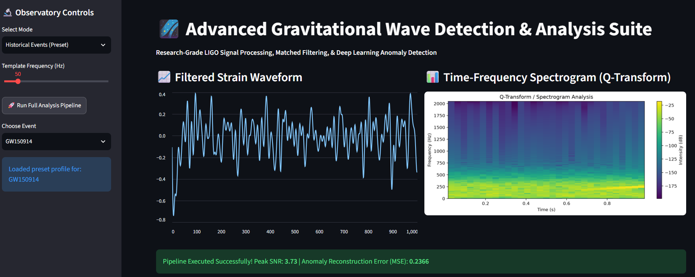
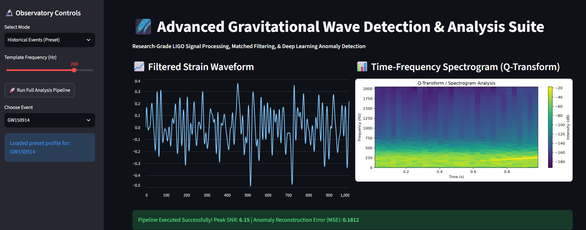
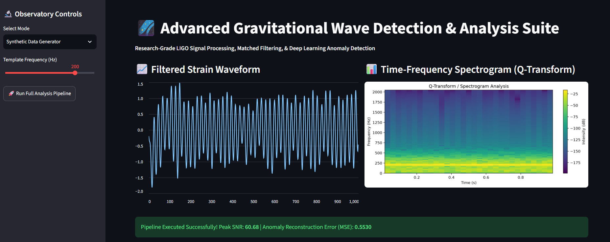

🌌 Advanced Gravitational Wave Detection & Analysis Suite

A research-grade Python software suite for processing time-series strain data, executing matched filtering, performing Q-transform spectrogram analysis, and detecting anomalies using 1D Convolutional Autoencoders.

📸 Interface & Dashboard

1. Main Dashboard Overview

2. High Frequency Parameter Tuning

3. Synthetic Pipeline Execution

⚡ Key Features

Multi-Source Data Ingestion: Supports pre-loaded historical LIGO events (e.g., GW150914), synthetic chirp wave generation, and custom time-series file uploads (.csv, .npy).
Signal Preprocessing: Digital Butterworth bandpass filtering ($20 - 300\text{ Hz}$) for strain noise suppression.
Matched Filtering Engine: Cross-correlation analysis to compute optimal Signal-to-Noise Ratio (SNR) peak detection.
Deep Learning Anomaly Detection: PyTorch-based 1D Convolutional Autoencoder for background noise baseline modeling and Mean Squared Error (MSE) reconstruction evaluation.
Time-Frequency Spectrograms: Dynamic Q-transform visualizations powered by Matplotlib and SciPy.

📁 Repository Structuregravitational-wave-detection/
├── assets/
│   ├── dashboard_overview.png
│   ├── high_frequency_analysis.png
│   └── synthetic_pipeline_run.png
├── src/
│   ├── __init__.py
│   ├── matched_filter.py
│   ├── model.py
│   ├── preprocessing.py
│   ├── train.py
│   └── utils.py
├── app.py
├── gw_autoencoder.pth
├── requirements.txt
└── README.md

🚀 Getting Started

Prerequisites
Python 3.9+
PyTorch
Streamlit
SciPy & NumPy
Matplotlib & Pandas

1. Installation
Clone the repository and install required packages:

git clone https://github.com/your-username/gravitational-wave-detection.git
cd gravitational-wave-detection
pip install -r requirements.txt

2. Model Training (Optional)
To train the 1D Autoencoder model on background noise and update model weights:python src/train.py

3. Launch Application
Run the interactive Streamlit dashboard:streamlit run app.py

🛠️ Tech Stack
Language: Python
Deep Learning Framework: PyTorch
Signal Processing: SciPy, NumPy
Frontend / Dashboard: Streamlit
Visualization: Matplotlib
